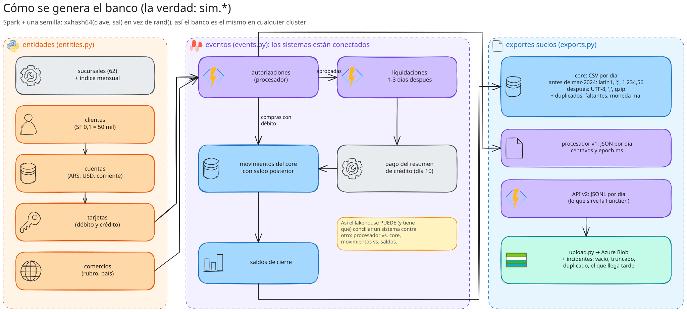
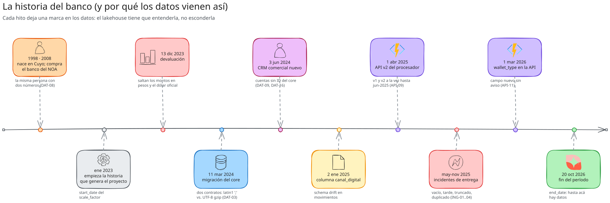

# 05 · Etapa 03 (I) · La empresa en código: sucursales, clientes, cuentas y tarjetas

## 🎯 Objetivo

Generar con Spark las **entidades** del banco: 62 sucursales, clientes (50 mil a SF 0,1), sus cuentas, sus tarjetas
y los comercios donde compran. Con una semilla: **el mismo banco cada vez**, en tu máquina o en Databricks.

Esto es la **verdad** (`sim.*`). El lakehouse nunca la lee: le llega sólo lo que exportan los sistemas, sucio. La
verdad sirve para que los tests digan si el pipeline recuperó lo que pasó.



**Archivos:** `src/andes_bank/generator/{reference,rand,entities}.py`, `tests/test_truth.py`.

## 📚 Conceptos

- **Datos de referencia** (`reference.py`): lo que no es azar: sucursales por ciudad, nombres y apellidos, rubros,
  feriados, el índice de precios y el dólar de fin de mes (inspirados en 2023-2026, redondeados).
- **Aleatoriedad determinística** (`rand.py`): en vez de `F.rand()`, un hash de la clave de la fila y una "sal":

  ```python
  def uniform(*cols, salt: str) -> Column:
      return F.pmod(F.xxhash64(*parts, F.lit(salt)), F.lit(_MOD)) / F.lit(float(_MOD))
  ```

  `F.rand()` depende de cómo se reparten las filas entre particiones: otro cluster, otro banco. `xxhash64(clave, sal)`
  da **siempre** el mismo número para la misma fila.
- **La historia vive en los datos:** el banco nació en Cuyo (1998), compró el del NOA (2008), abrió en el Centro
  (2016) y es digital desde 2020. Eso define la región, la antigüedad y, sobre todo, un problema: **la misma persona
  con dos números de cliente** (DAT-08).



## 🧱 Paso a paso

### 1. Clientes (`entities.customers_df`)

Todo sale de `spark.range` y de `uniform` con una sal distinta por atributo:

```python
base = spark.range(1, n + 1).withColumnRenamed("id", "customer_key")
u = lambda salt: uniform("customer_key", salt=f"{s}-cust-{salt}")
df = (base.withColumn("region", weighted_pick(u("region"), regions, weights))
          .withColumn("segment", weighted_pick(u("segment"), ref.SEGMENTS, ref.SEGMENT_WEIGHTS))
          # DNI correlacionado con la edad (los más jóvenes tienen números más altos), como en la realidad
          .withColumn("dni", (F.lit(47_000_000) - F.col("age_2023") * 520_000 + int_between(u("dni"), 0, 900_000)))
          .withColumn("cuit", F.when(F.col("person_type") == "JURIDICA", cuit_company_col(...))
                               .otherwise(cuit_col(F.col("dni"), F.col("female")))))
```

**El detalle que importa:** cada atributo tiene **su** sal (`"region"`, `"segment"`, `"dni"`). Si usaras la misma,
todos los atributos estarían correlacionados (los clientes del NOA serían siempre PyME, por ejemplo).

### 2. La fusión de 2008 (DAT-08)

Una parte de los clientes del NOA ya eran clientes de Cuyo: se generan **dos filas** con distinto `customer_id`
(`NOA-…` y `CUY-…`), el mismo DNI y el mismo `person_id`. El core no lo sabe; silver lo tiene que descubrir
(capítulo 17). Las columnas `person_id` e `is_legacy_duplicate` son **verdad**: el core no las exporta.

### 3. Cuentas, tarjetas y comercios

- **Cuentas:** caja de ahorro en pesos (todos), en dólares (40 %), cuenta corriente (15 %, más en PyME y Premium).
  Cada una con su **CBU válido** (capítulo 04).
- **Tarjetas:** débito asociada a la caja de ahorro en pesos; crédito Visa o Mastercard para el 35 %.
- **Comercios:** rubro (MCC), ciudad y país. ~4 % son del exterior: compras en dólares.

### 4. Materializar cada paso (`truth.py`)

```python
_save(entities.customers_df(spark, cfg), cfg, "customers")
_save(entities.accounts_df(t("customers"), cfg), cfg, "accounts")      # lee la tabla, no el DataFrame
```

Cada tabla se escribe y se **vuelve a leer**. Si encadenás DataFrames sin materializar, Spark recalcula todo el
linaje en cada paso, y con 17 M de movimientos eso es carísimo.

## 🤔 Por qué así

- **¿Por qué Spark y no Faker en Python?** Porque a SF 1 son 500 mil clientes y ~170 M de movimientos. Python puro no
  llega; Spark sí, y en Free Edition el cómputo es gratis.
- **¿Por qué escalar clientes y no días?** Porque la historia (devaluación, migración, API v2) tiene que estar
  completa a cualquier escala; lo que cambia es cuánta gente la vive.

## 🧪 Probalo

```bash
pytest -q tests/test_truth.py -k "reproducible or validos"
```

Los tests generan el banco a 1.000 clientes y comprueban: volumen razonable, IDs únicos, **todos** los CUIT y CBU
válidos.

## 🔥 Si falla

| síntoma | causa | arreglo |
|---|---|---|
| Dos corridas dan bancos distintos | usaste `F.rand()` o `random` sin semilla en algún lado | todo con `uniform(..., salt=...)` |
| Clientes del NOA siempre PyME (u otra correlación rara) | dos atributos con la misma sal | una sal distinta por atributo |
| El generador tarda muchísimo | DataFrames encadenados sin materializar | `_save` + `spark.table` en cada paso |

## ✅ Punto de control

`git diff etapa-03 -- src/andes_bank/generator/entities.py src/andes_bank/generator/rand.py`

## 🏋️ Ejercicio

Agregá a los clientes un atributo `canal_preferido` (sucursal, app, homebanking) que dependa del segmento y de la
edad, con su propia sal. Verificá que dos corridas dan lo mismo.
