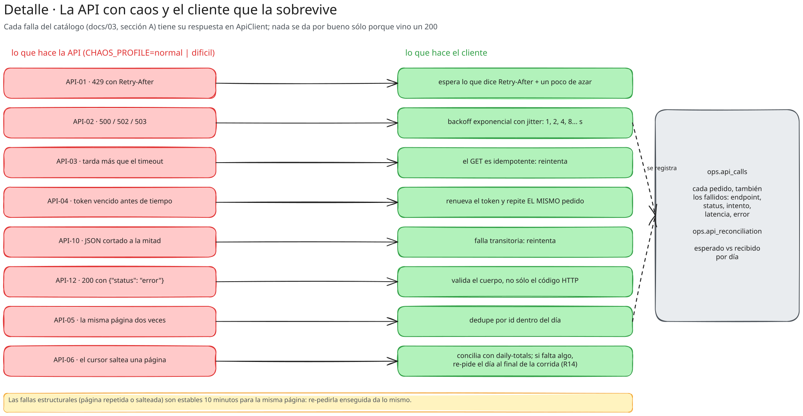

# 09 · Etapa 06 · La API de tarjetas: OAuth, cursor, v1/v2 y caos

## 🎯 Objetivo

Una API en Azure Functions que se porte como la de un procesador de tarjetas real, **incluidas sus fallas**:

- OAuth 2.0 *client credentials* con tokens de 15 minutos;
- `v2` paginada por **cursor** y `v1` (legacy) por **offset**;
- endpoint de **totales diarios** para conciliar;
- **caos** configurable: 429, 5xx, timeouts, tokens que vencen antes, páginas repetidas o salteadas.

**Archivos:** `azure/card_api/{api,chaos,store,tokens,function_app}.py`, `tests/test_card_api.py`.



## 📚 Conceptos

- **Sin base de datos:** la API lee páginas **pre-armadas** en Blob (`api-data/authorizations/2025/07/15/page-00001.json`
  + `_manifest.json`). Cada pedido lee un blob: sirve millones de filas por centavos.
- **Cursor vs. offset:** con offset (`?offset=400&limit=200`), si entran filas nuevas mientras paginás, todo se corre y
  duplicás o perdés filas en el borde (API-07). Un cursor apunta a una posición estable.
- **Fallas transitorias vs. estructurales:**
  - *transitorias* (429, 5xx, timeout, token vencido): azar en cada pedido; un reintento bien hecho las supera;
  - *estructurales* (página repetida, página salteada): estables durante 10 minutos para la misma página. Pedirla de
    nuevo enseguida da lo mismo: hay que **conciliar** contra los totales y volver un rato después (R14).

## 🧱 Paso a paso

### 1. La lógica, sin Azure (`api.py`)

`CardApi.handle(request) → (status, headers, body)`. `function_app.py` sólo traduce entre Azure Functions y esto, así
**todo se prueba con pytest**:

```python
def handle(self, req):
    if path == "/oauth/token" and req.method == "POST":
        return self._token(req)
    if parts[0] == "v2" and parts[1] in DATE_PARAM:
        return self._guarded(req, lambda: self._page_v2(req, parts[1]), pageable=True)
```

### 2. Los tokens (`tokens.py`)

Un token es `base64(payload).firma_hmac`. No hace falta guardar nada: la Function verifica la firma con su clave.

### 3. El caos (`chaos.py` y `_guarded`)

```python
PROFILES = {"off": ChaosProfile(),
            "normal": ChaosProfile(rate_limit=0.03, server_error=0.02, slow=0.003, early_expiry=0.01,
                                   duplicate_page=0.01, skipped_page=0.005, unstable_offset=0.3),
            "dificil": ChaosProfile(...)}

def structural(self, rate, *keys) -> bool:
    bucket = int(self.clock() // 600)                    # estable 10 minutos para la misma (fecha, página)
    h = hashlib.sha256("|".join(str(k) for k in (self.seed, bucket, *keys)).encode()).digest()
    return int.from_bytes(h[:8], "big") / 2**64 < rate
```

`_guarded` aplica, en orden: token válido → 429 → 5xx → lentitud → la respuesta → (si es paginable) JSON cortado o
"200 con error".

### 4. v2 con cursor y v1 con offset

El cursor es `base64({"d": día, "p": página})`. Con caos, `next_cursor` puede repetir la página (API-05) o saltear una
(API-06). En v1, el offset se corre al azar entre pedidos (API-07) y los montos vienen en centavos.

### 5. Desplegar (`03_deploy_api.sh`)

```bash
bash scripts/azure/03_deploy_api.sh          # zip + build remoto + prueba /api/health
```

## 🤔 Por qué así

- **¿Por qué una API propia y no una pública?** Porque ninguna API pública de tarjetas te deja controlar las fallas.
  Acá cada falla del catálogo existe, tiene ID y se puede prender o apagar (`CHAOS_PROFILE`).
- **¿Por qué el caos estructural depende del reloj?** Porque en la vida real una página salteada no se arregla
  pidiéndola tres veces seguidas. Eso obliga a escribir un cliente que concilie (capítulo 14).

## 🧪 Probalo

```bash
pytest -q tests/test_card_api.py
curl -s https://<func>.azurewebsites.net/api/health      # {"status": "ok", "chaos": {...}}
```

## 🔥 Si falla

| síntoma | causa | arreglo |
|---|---|---|
| `/api/health` no responde tras el deploy | el build remoto todavía corre o falló | `az functionapp log tail -n <func> -g rg-andes-bank` |
| `401 invalid_client` | el client id/secret no es el de la Function | volvé a correr `02_secrets.sh` (rota los dos lados a la vez) |
| `404 No existe GET /crm/v1/...` | Function desplegada antes de la etapa 08 | `03_deploy_api.sh` |

## ✅ Punto de control

`git diff etapa-06 -- azure/card_api/api.py azure/card_api/chaos.py azure/card_api/tokens.py`

## 🏋️ Ejercicio

Agregá un perfil `caos_total` con todas las fallas al 20 % y corré los tests del cliente (capítulo 14) contra él.
¿Cuántos pedidos hacen falta para traer un día completo?
