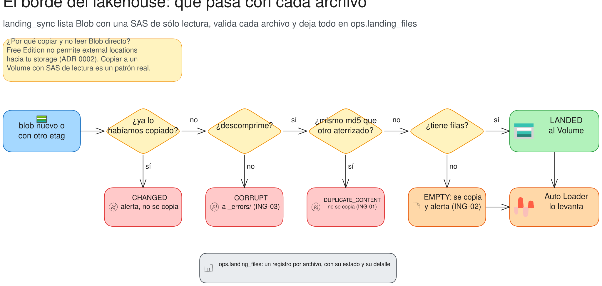

# 12 · Etapa 09 (I) · Landing: de Blob al Volume, con validación en el borde

## 🎯 Objetivo

Traer los archivos de los sistemas origen desde Azure Blob a un **Volume** de Unity Catalog, y **validar cada uno en
el borde** antes de dejarlo pasar: vacío, corrupto, duplicado con otro nombre o modificado después de entregado.

**Archivos:** `src/andes_bank/ingestion/landing_sync.py`, `notebooks/10_landing_sync.py`, `tests/test_ingestion.py`,
[ADR 0002](../docs/adr/0002_landing_sync_blob_a_volume.md).



## 📚 Conceptos

- **Volume:** una carpeta gobernada por Unity Catalog (`/Volumes/andes_bank/landing/raw/...`). Auto Loader la lee
  como si fuera un storage cualquiera.
- **etag:** la "versión" de un blob. Si el etag cambió, alguien lo volvió a subir.
- **md5 del contenido:** dos archivos con el mismo md5 son el mismo archivo, aunque se llamen distinto (ING-01).
- **Validar en el borde:** es mucho más barato rechazar un archivo roto **antes** de que entre que limpiar después
  una tabla bronze con filas basura.

## 🧱 Paso a paso

### 1. Inspeccionar un archivo, sin Spark (`inspect`)

```python
def inspect(name: str, data: bytes) -> tuple[str, int | None, str | None]:
    raw = data
    if name.endswith(".gz"):
        try:
            raw = gzip.decompress(data)
        except (EOFError, OSError, zlib.error) as exc:
            return "CORRUPT", None, f"{type(exc).__name__}: {str(exc)[:200]}"
    lines = [ln for ln in raw.splitlines() if ln.strip()]
    rows = len(lines) - 1 if name.endswith((".csv", ".csv.gz")) else len(lines)      # el CSV tiene encabezado
    return ("EMPTY" if rows <= 0 else "LANDED"), max(rows, 0), None
```

### 2. Decidir qué hacer con cada uno (`sync`)

```python
todo = [f for f in files if known.get((f.container, f.name)) != f.etag]       # sólo lo nuevo o cambiado
for f, data in downloaded:
    md5 = hashlib.md5(data).hexdigest()
    if (f.container, f.name) in known:
        status = "CHANGED"                         # ya lo habíamos copiado y cambió: alerta, no se re-copia
    status, rows, detail = inspect(f.name, data)
    if status != "CORRUPT" and md5 in known_md5:
        status = "DUPLICATE_CONTENT"               # mismo contenido que otro: no se copia
    elif status == "CORRUPT":
        target = os.path.join(cfg.errors_path("landing"), f.container, f.name)      # a _errors/, no al Volume
```

Las descargas van en paralelo (`ThreadPoolExecutor`, 16 a la vez): con miles de archivos chicos, la red es el cuello
de botella, no el CPU.

### 3. Registrar todo (`run_sync`)

Cada archivo deja una fila en `ops.landing_files` con su estado, filas, md5 y detalle. El Genie Agent de Plataforma
responde "¿qué archivo llegó corrupto?" con esa tabla.

## 🤔 Por qué así

- **¿Por qué no re-copiar un archivo `CHANGED`?** Porque Auto Loader ya lo leyó: re-copiarlo con el mismo nombre no
  lo vuelve a leer, y con otro nombre duplica filas. Un archivo que cambia después de entregado es un incidente que
  una persona tiene que mirar.
- **¿Por qué `EMPTY` sí se copia?** Porque no rompe nada y deja rastro: el reenvío del día siguiente (`_REENVIO`) trae
  los datos (ING-02).

## 🧪 Probalo

```bash
pytest -q tests/test_ingestion.py -k sync
databricks bundle run andes_lakehouse -t dev --only landing_sync
```

En el SQL editor:

```sql
SELECT status, count(*) FROM andes_bank.ops.landing_files GROUP BY ALL;
-- LANDED muchos, EMPTY 1, CORRUPT 1, DUPLICATE_CONTENT 1
```

## 🔥 Si falla

| síntoma | causa | arreglo |
|---|---|---|
| Free Edition no deja crear la *external location* | no admite storage propio | copia con SAS a un Volume (R05, ADR 0002) |
| Todos los archivos salen `CHANGED` | se re-subieron a Blob | `upload_all(skip_existing=True)` (R07) |
| `AuthenticationFailed` al listar Blob | la SAS de lectura venció o se rotó | `02_secrets.sh` y volver a correr |

## ✅ Punto de control

`git diff etapa-09 -- src/andes_bank/ingestion/landing_sync.py`

## 🏋️ Ejercicio

Agregá un estado `TOO_BIG` para archivos de más de 500 MB (no se copian y alertan). ¿Dónde lo testeás sin subir un
archivo de 500 MB?
