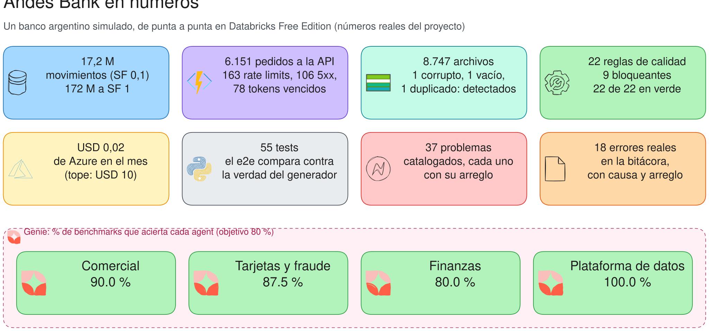

# 27 · Etapa 24 · Contarlo: el posteo de LinkedIn

## 🎯 Objetivo

Contar el proyecto **con números reales**, no con adjetivos. El posteo terminado (y las respuestas a las 20
preguntas guía) está en [docs/07](../docs/07_posteo_linkedin.md).



## 📚 Conceptos

- **Un número le gana a un adjetivo.** "Un pipeline robusto" no dice nada; "6.151 pedidos a la API, 163 rate limits,
  ningún día incompleto" sí.
- **Contá un error.** El mejor párrafo del posteo es la bitácora R14: el bug que encontró el quality gate y no los
  tests. Muestra cómo pensás, no sólo qué sabés.
- **La IA, con honestidad:** qué decidiste vos, qué le pediste, qué corregiste. "Lo hizo la IA" no suma; "la IA
  propuso X, lo medí y estaba mal por Y" sí.

## 🧱 Paso a paso

### 1. Sacá los números de tus tablas

```sql
SELECT count(*) FROM andes_bank.silver.transactions;                                   -- volumen
SELECT api, resultado, count(*) FROM andes_bank.semantic.v_api_llamadas GROUP BY ALL;   -- el caos que sobreviviste
SELECT status, count(*) FROM andes_bank.ops.landing_files GROUP BY ALL;                 -- lo que se frenó en el borde
```

```bash
bash scripts/azure/04_costo.sh                       # el costo del mes
python scripts/genie_benchmark.py                    # el % de aciertos de cada agent
```

### 2. Regenerá el diagrama "en números"

`scripts/diagramas/generar.py` (`en_numeros`) lee los porcentajes de `genie/benchmarks_dev.json`: corré el benchmark,
regenerá y exportá el diagrama. La imagen del posteo es ésa.

### 3. Escribí el posteo

Usá las preguntas de `docs/07` como guion: qué hiciste, por qué, cómo usaste la IA, qué aprendiste. Cuatro párrafos
cortos, un diagrama y el link al repo.

## 🤔 Por qué así

- **¿Por qué un diagrama y no una captura?** Una captura de Databricks se ve igual en todos los posteos; un diagrama
  propio cuenta **tu** arquitectura y tus números.

## ✅ Punto de control

`docs/07_posteo_linkedin.md` con tus números y tu diagrama `17_en_numeros.svg` actualizado.

## 🏋️ Ejercicio

Escribí una versión de 3 líneas del posteo para alguien que no es técnico (tu familia, un reclutador). ¿Qué número
dejás?
