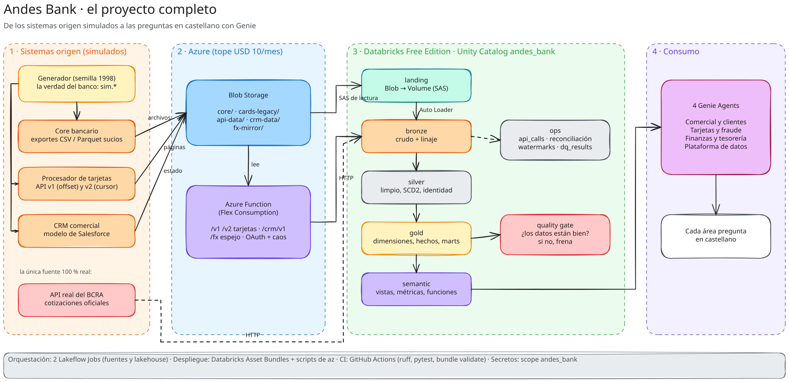
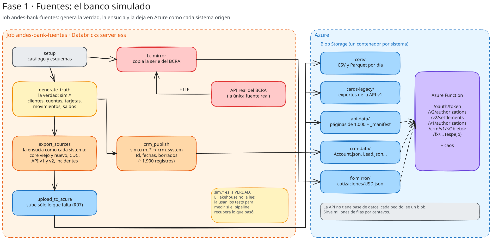
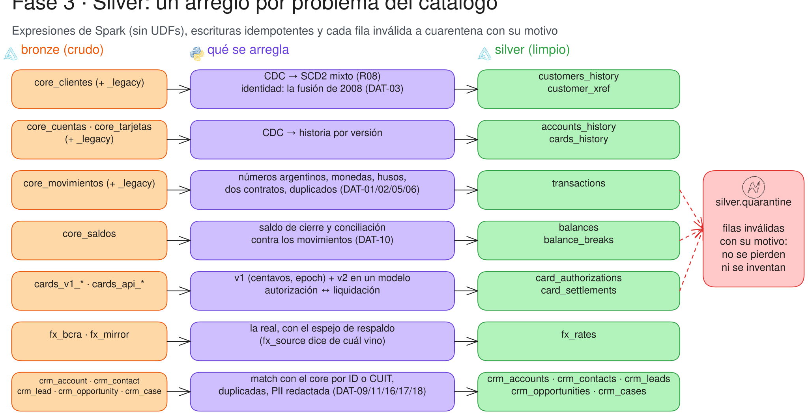
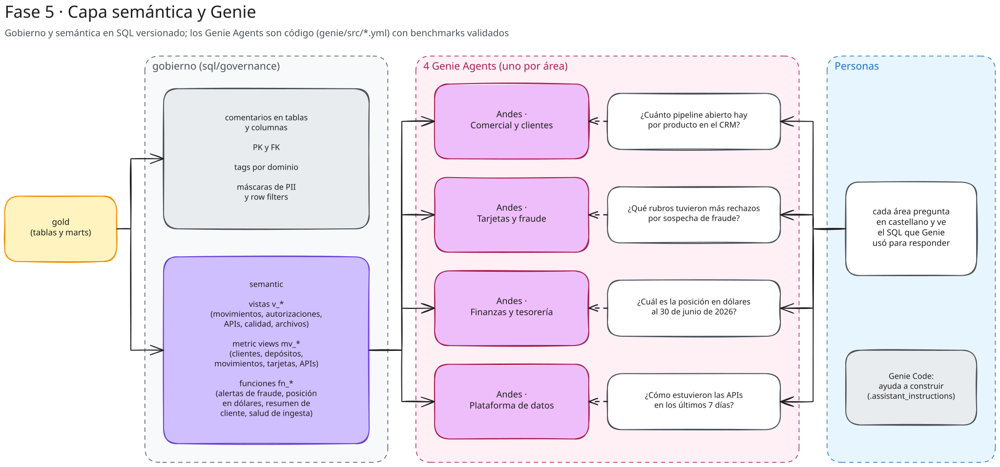
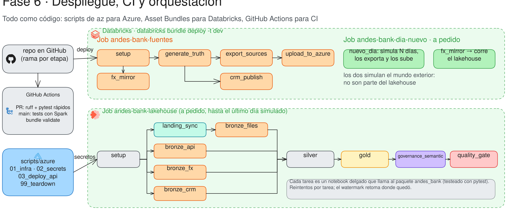
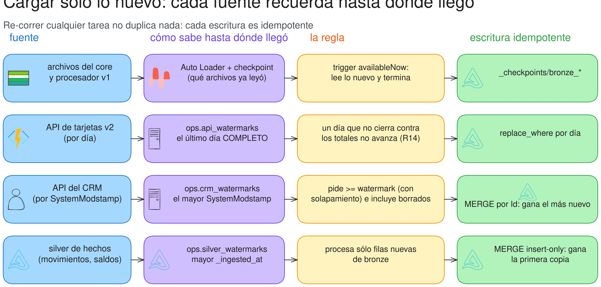
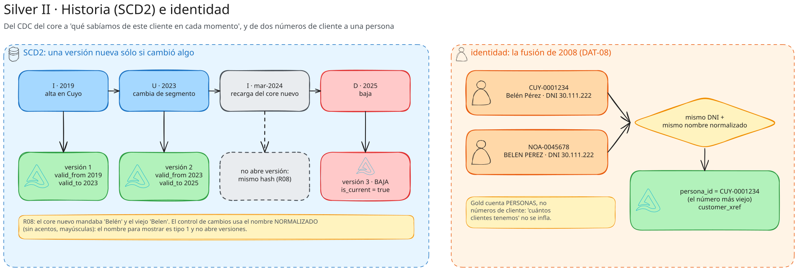
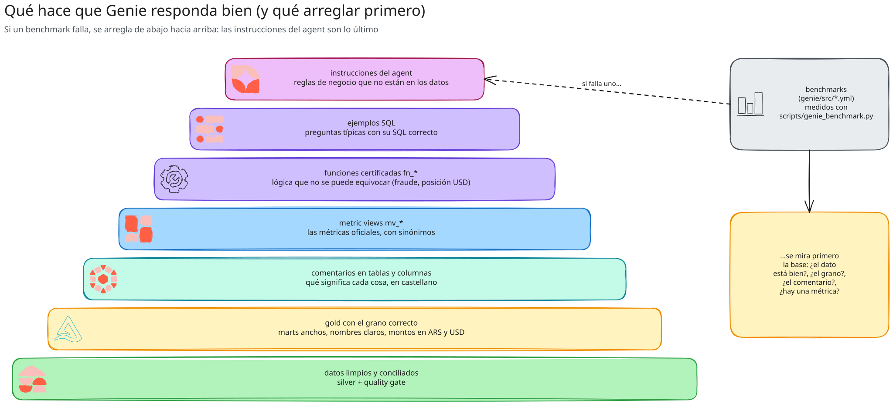
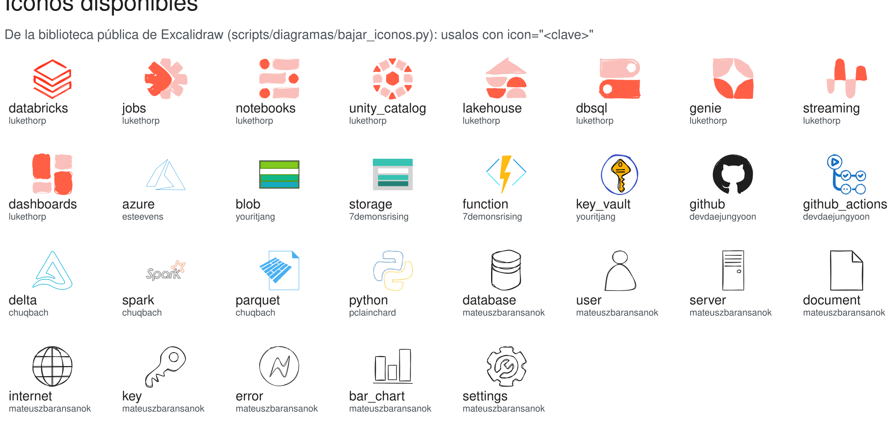

# Diagramas del proyecto

Un diagrama por fase (00 a 07) y uno por concepto clave (08 a 16), dibujados con [Excalidraw](https://excalidraw.com). Cada uno está en dos formatos:

- **`.excalidraw`**: el original, editable. Abrilo en <https://excalidraw.com> (*Abrir* → elegí el archivo) o con la
  extensión de Excalidraw para VS Code.
- **`.svg`**: el exportado, que es lo que muestra GitHub.

| # | diagrama | de qué trata |
|---|---|---|
| 00 | [Panorama](#00--el-proyecto-completo) | el proyecto completo, de las fuentes a Genie |
| 01 | [Fuentes](#01--fuentes-el-banco-simulado) | el job que simula el banco y lo deja en Azure |
| 02 | [Ingesta](#02--ingesta-de-las-fuentes-a-bronze) | de Blob, la API y el BCRA a bronze |
| 03 | [Silver](#03--silver-un-arreglo-por-problema) | qué se arregla en cada fuente |
| 04 | [Gold y calidad](#04--gold-y-quality-gate) | el modelo dimensional, los marts y el quality gate |
| 05 | [Semántica y Genie](#05--capa-semántica-y-genie) | gobierno, vistas, métricas, funciones y los 4 agents |
| 06 | [Despliegue y jobs](#06--despliegue-ci-y-orquestación) | CI, Asset Bundles y las tareas de cada job |
| 07 | [La API y el cliente](#07--la-api-con-caos-y-el-cliente) | cada falla inyectada y cómo se sobrevive |
| 08 | [La historia del banco](#08--la-historia-del-banco) | cada hito (fusión, devaluación, migración, API v2) y la marca que deja en los datos |
| 09 | [El generador](#09--el-generador) | entidades → eventos conectados → exportes sucios |
| 10 | [El borde (landing)](#10--el-borde-landing) | qué pasa con cada archivo: LANDED, EMPTY, CORRUPT, DUPLICATE, CHANGED |
| 11 | [Cargar sólo lo nuevo](#11--cargar-sólo-lo-nuevo) | checkpoints y watermarks de cada fuente |
| 12 | [R14: el día incompleto](#12--r14-el-día-incompleto) | el bug que encontró el quality gate y cómo se arregló |
| 13 | [SCD2 e identidad](#13--scd2-e-identidad) | historia de clientes y la fusión de 2008 |
| 14 | [El modelo estrella](#14--el-modelo-estrella) | hechos, dimensiones y marts de gold |
| 15 | [La pirámide de Genie](#15--la-pirámide-de-genie) | qué hace que Genie responda bien y qué arreglar primero |
| 16 | [Operar con el caos](#16--operar-con-el-caos) | qué mirar y qué hacer cuando falla cada tarea del job diario |
| 99 | [Íconos disponibles](#99--íconos-disponibles) | los íconos de la biblioteca de Excalidraw que usan los diagramas |

## Cómo se regeneran

Los diagramas son **código**: se escriben en `scripts/diagramas/generar.py` con una mini-librería
(`scripts/diagramas/excali.py`). Si cambia la arquitectura, se cambia ahí y se regenera:

```bash
python scripts/diagramas/bajar_iconos.py                # sólo si cambia la lista de íconos → iconos.json
python scripts/diagramas/generar.py                     # → docs/diagramas/*.excalidraw
cd scripts/diagramas && npm install && node exportar.mjs   # → docs/diagramas/*.svg  (--png para PNG)
```

`exportar.mjs` usa la librería de Excalidraw dentro de Chromium (Playwright) y le incrusta la tipografía, porque GitHub
no deja que un SVG cargue fuentes externas. Si editás un `.excalidraw` a mano en excalidraw.com, exportalo a SVG desde
ahí; pero la próxima regeneración lo pisa: para que el cambio quede, pasalo a `generar.py`.

## Íconos

Los íconos salen de la [biblioteca pública de Excalidraw](https://libraries.excalidraw.com) (licencia MIT, cada uno
de su autor):

| biblioteca | autor | íconos |
|---|---|---|
| Databricks Architecture Icons | lukethorp | Databricks, Lakeflow Jobs, Notebooks, Unity Catalog, Lakehouse, Genie, Streaming, Dashboards |
| Azure cloud services icons | youritjang | Blob Storage, Key Vault |
| Azure Compute / Azure Storage | 7demonsrising | Function App, Storage Accounts |
| Some more logos | esteevens | Azure |
| GitHub Actions | devdaejungyoon | GitHub, GitHub Actions |
| Data Platform | chuqbach | Delta Lake, Spark, Parquet |
| IT Logos | pclainchard | Python |
| IT icons | mateuszbaransanok | base de datos, usuario, servidor, documento, internet, llave, error, gráfico, engranaje |

`bajar_iconos.py` los baja y guarda en `scripts/diagramas/iconos.json` sólo el dibujo (sin el nombre ni los marcos
invisibles). En `generar.py` se usan con `icon="<clave>"` en una caja o en una zona: el ícono va a la izquierda del
texto y, si no entra, arriba. Para sumar uno, agregalo a `ICONOS` en `bajar_iconos.py` y volvé a correrlo.

## 00 · El proyecto completo



## 01 · Fuentes: el banco simulado



## 02 · Ingesta: de las fuentes a bronze


## 03 · Silver: un arreglo por problema



## 04 · Gold y quality gate


## 05 · Capa semántica y Genie



## 06 · Despliegue, CI y orquestación



## 07 · La API con caos y el cliente


## 08 · La historia del banco


## 09 · El generador


## 10 · El borde (landing)


## 11 · Cargar sólo lo nuevo



## 12 · R14: el día incompleto


## 13 · SCD2 e identidad



## 14 · El modelo estrella


## 15 · La pirámide de Genie



## 16 · Operar con el caos


## 99 · Íconos disponibles


