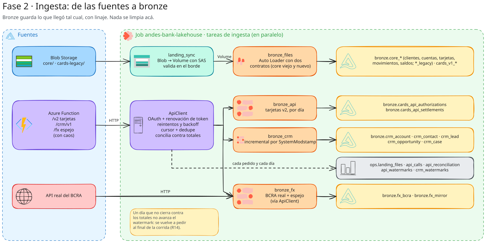
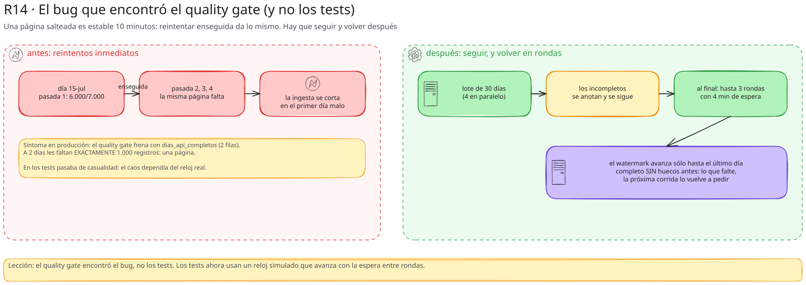

# 04 · Ingesta: landing y bronze

> Carpeta `src/andes_bank/ingestion/`. Cómo entran los datos al lakehouse: los **archivos** (Blob → Volume →
> Auto Loader → bronze) y las **APIs** (cliente robusto → bronze). Es la capa donde más se aprende a diseñar para la
> falla.

## 1. Los cinco módulos

| módulo | entrada | salida | tarea del job |
|---|---|---|---|
| `landing_sync.py` | contenedores `core` y `cards-legacy` de Azure | archivos en el Volume + `ops.landing_files` | `landing_sync` |
| `bronze_files.py` | archivos del Volume | 12 tablas `bronze.core_*` y `bronze.cards_v1_*` | `bronze_files` |
| `api_client.py` | — (lo usan los otros) | pedidos HTTP robustos + registro en memoria | — |
| `bronze_api.py` | API v2 de tarjetas, BCRA real, espejo | `bronze.cards_api_*`, `bronze.fx_bcra`, `bronze.fx_mirror`, `ops.api_*` | `bronze_api`, `bronze_fx` |
| `bronze_crm.py` | API del CRM | `bronze.crm_*` + `ops.crm_watermarks` | `bronze_crm` |

## 2. `landing_sync.py`: el borde

### Por qué copiar y no leer Blob directo

Lo natural sería que Auto Loader lea `abfss://…` directamente. En Free Edition **no se puede**: no hay *external
locations* hacia storage propio, y el cómputo serverless no acepta credenciales de Azure en la configuración de Spark
(bitácora R05, [ADR 0002](../adr/0002_landing_sync_blob_a_volume.md)). La solución es un patrón real (el "copy to
landing" de ADF o Fivetran): copiar lo nuevo al Volume `landing.raw` con una **SAS de sólo lectura**, y que Auto
Loader lea del Volume.

### Validar en el borde

La copia no es ciega: cada archivo se inspecciona **antes** de dejarlo pasar, y el resultado queda en
`ops.landing_files` (una fila por blob y versión).

| estado | cuándo | qué se hace |
|---|---|---|
| `LANDED` | se copió y tiene filas | Auto Loader lo va a levantar |
| `EMPTY` | se copió pero sólo trae encabezado (ING-02) | queda registrado y alerta (regla `archivos_vacios`) |
| `CORRUPT` | no se puede descomprimir (ING-03) | va a `_errors/landing/`, **no** al Volume: no envenena bronze |
| `DUPLICATE_CONTENT` | mismo **md5** que otro archivo ya aterrizado, con otro nombre (ING-01) | no se copia |
| `CHANGED` | el blob ya se procesó y ahora tiene **otro etag** (el origen lo re-subió) | alerta; no se re-copia (lo entregado no se cambia) |

### Funciones

- `RemoteFile`: un blob (contenedor, nombre, etag, tamaño y una función `fetch` para bajarlo). Abstrae Azure: en los
  tests es una lista de `RemoteFile` en memoria.
- `inspect(name, data)`: descomprime si es `.gz` (un `EOFError`/`zlib.error` = `CORRUPT`) y cuenta líneas (menos el
  encabezado en CSV).
- `sync(cfg, files, known, known_md5, workers=16)`: filtra lo que ya se procesó con el **mismo etag**, baja lo nuevo en
  paralelo (16 hilos), decide el estado, escribe el archivo donde corresponde y devuelve un `SyncResult` por blob.
- `azure_files(account, sas, containers)`: lista los blobs con el SDK de Azure.
- `run_sync(spark, cfg, files)`: lee lo ya conocido de `ops.landing_files` (etag por blob y md5 de lo aterrizado),
  sincroniza y agrega los resultados.

## 3. `bronze_files.py`: Auto Loader con dos contratos

### Principios de bronze

1. **Lo que llegó, tal cual llegó.** Todo como **texto**: los tipos se aplican en silver. Así un `1.234,56` no se
   pierde ni se convierte mal en bronze.
2. **Linaje.** Cada fila sabe de qué archivo vino (`_source_file`), qué día se entregó (`_delivery_date`, sacado de la
   carpeta `yyyy/mm/dd`) y cuándo se cargó (`_ingested_at`). `add_lineage()` lo agrega desde `_metadata.file_path`.
3. **Incremental.** Auto Loader lleva un checkpoint: cada corrida procesa sólo archivos nuevos (`trigger(availableNow=True)`:
   procesa lo pendiente y termina, como un batch).

### Dos contratos por fuente del core

El core cambió de sistema en mar-2024. En vez de mezclar los dos formatos en una tabla (que escondería el problema),
cada fuente tiene **dos tablas bronze**: `core_<fuente>_legacy` (latin1, `;`, `*.csv`, columnas en mayúscula) y
`core_<fuente>` (UTF-8, `,`, `*.csv.gz`, snake_case). Silver las unifica. El `pathGlobFilter` (`*.csv` vs `*.csv.gz`) es
lo que separa un contrato del otro dentro de la misma carpeta.

`SOURCES` define las 12 fuentes como `FileSource(table, system, folder, fmt, glob, columns, sep, encoding,
late_columns)`: clientes, cuentas, tarjetas, movimientos y saldos (×2) y los JSON v1 de autorizaciones y liquidaciones.

### `read_stream`

En Databricks: `cloudFiles` con

- `schemaLocation` (donde Auto Loader guarda el esquema inferido y su evolución),
- `schemaEvolutionMode = addNewColumns` (una columna nueva amplía el esquema),
- `rescuedDataColumn = _rescued_data` (lo que no encaja en el contrato no se pierde),
- `maxFilesPerTrigger = 200`,
- CSV: `inferColumnTypes = false` y el contrato como `schemaHints` (todo STRING); JSON: tipos inferidos, con hints
  `BIGINT` para los montos en centavos (en un archivo chico la inferencia podría elegir INT y desbordar).

En local (tests): `readStream` normal de CSV/JSON con el esquema explícito (Auto Loader sólo existe en Databricks).

### `ingest` y el schema drift (ING-05)

Cuando aparece `canal_digital` (desde 2025), Auto Loader con `addNewColumns` **guarda el esquema ampliado y detiene el
stream** con `UNKNOWN_FIELD_EXCEPTION`: es su forma de avisar. `ingest` lo reinicia hasta 3 veces y retoma con el
esquema nuevo. Escribe con `mergeSchema` para que la tabla Delta acepte la columna. Devuelve las filas nuevas.

`ingest_all` corre todas las fuentes; una fuente que todavía no mandó archivos (`PATH_NOT_FOUND`) cuenta 0 en vez de
romper.

## 4. `api_client.py`: el cliente robusto

Un `ApiClient` (dataclass) habla con cualquier API con OAuth `client_credentials`. Todo lo inyectable lo es (`session`,
`sleep`, `clock`, `rng`): los tests le pasan una sesión falsa y un reloj simulado.

### `get(path, params)`: un pedido, problema por problema

| situación | qué hace | por qué |
|---|---|---|
| timeout o corte de red (API-03) | reintenta con backoff | el GET es idempotente |
| **401** (API-04) | renueva el token y repite **el mismo pedido** (mismo cursor); **no** cuenta como intento fallido (hasta 3 renovaciones) | perder la página 37 de 50 por un token vencido sería absurdo |
| **429** (API-01) | espera lo que dice `Retry-After` + hasta 1 s de azar | respetar al proveedor; el azar evita que todos los hilos vuelvan juntos |
| **5xx** (API-02) | backoff exponencial con *jitter*: `min(30, 2^(n−1)) × (0,5 a 1,5)` | no martillar a un servidor caído |
| otro 4xx | `ApiError` inmediato | un 400 o 404 no se arregla reintentando |
| JSON inválido (API-10) | reintenta | el cuerpo vino cortado |
| 200 con `{"status": "error"}` (API-12) | reintenta | se valida el **cuerpo**, no sólo el código HTTP |
| más de 8 intentos | `ApiError("Reintentos agotados")` | la tarea falla y el job la reintenta más tarde; el watermark no avanzó |

**Token:** `_bearer()` lo renueva si le quedan menos de 60 s (renovación anticipada).

**Registro:** cada pedido, también los fallidos, se agrega a `calls` (endpoint, parámetros sin el cursor, código,
intento, latencia, error, filas) y después va a `ops.api_calls`. Es la materia prima del agent Plataforma de datos.

**El lock reentrante (bitácora R06):** los tests quedaban colgados al 0 % de CPU. `_bearer()` toma el lock, renueva el
token, y `_log()` intenta tomar el **mismo** lock: un `threading.Lock` no es reentrante → *deadlock*. Se cambió por
`threading.RLock()`.

### `fetch_day(resource, day, id_field, date_param, max_passes=4)`: un día completo

1. Pide los **totales del día** (`daily-totals`): cuántos registros tiene que haber.
2. Recorre el día siguiendo el cursor, guardando los registros en un diccionario **por id** (una página repetida no
   duplica: API-05; cuenta `duplicates_seen`).
3. Si al final hay menos que el total (API-06, página salteada), vuelve a recorrer el día, hasta 4 pasadas.
   Si los totales dan **0**, el día todavía no se publicó (el job "día nuevo" no corrió): devuelve `ready = False` sin
   pedir páginas. Un día "completo con 0 registros" haría avanzar el watermark y ese día no se pediría nunca más
   (bitácora R19).
4. Devuelve un `DayResult` con los registros, lo esperado, pasadas, páginas leídas y duplicados; `complete` es
   `len(records) == expected`.

## 5. `bronze_api.py`: tarjetas y cotizaciones

### Tarjetas (`ingest_cards_api`)

- **Qué guarda:** una fila por registro con `record_id`, `raw` (**el JSON tal cual**, como texto), `_window_date` (el
  día pedido), `_api_version`, `_run_id`, `_ingested_at`. Silver lo parsea con un esquema explícito: un campo nuevo
  (`wallet_type`) no rompe bronze y aparece en silver cuando se lo agrega al esquema.
- **Watermark:** `ops.api_watermarks` guarda el **último día completo** por recurso. `days_to_fetch` arranca el día
  siguiente (o en el lanzamiento de la v2) y llega hasta `end_date`.
- **Idempotencia:** cada lote de días se escribe con `replace_where(_window_date IN (…))`: re-pedir un día lo
  reemplaza, no lo duplica.
- **Lotes y paralelismo:** 30 días por lote, 4 días en paralelo (`ThreadPoolExecutor`). Después de cada lote: una fila
  por día en `ops.api_reconciliation` (esperado, recibido, completo) y se vuelcan los pedidos a `ops.api_calls`.
- **Rondas de reintento (bitácora R14):** un día incompleto **no frena** la corrida. Se sigue con los demás y al final
  se vuelven a pedir los incompletos, en hasta **3 rondas con 4 minutos de espera**: como la página salteada es estable
  durante 10 minutos, reintentar enseguida da lo mismo; un rato después, no.
- **Días no publicados:** no se escriben en bronze ni en `ops.api_reconciliation` (el quality gate no los ve como
  incompletos), no entran en las rondas de reintento y frenan el watermark: quedan en `not_ready_days` del resumen.
- **El watermark avanza sólo hasta el último día completo sin huecos antes.** Si el 15 quedó incompleto y el 16
  completo, el watermark queda en el 14 y la próxima corrida pide el 15 y el 16 (el 16 se reemplaza, no se duplica).

**Así se encontró R14:** en la primera corrida real a 2 días les faltaban exactamente 1.000 registros y la ingesta se
cortaba en el primer día incompleto. En los tests pasaba de casualidad porque el caos dependía del reloj real; ahora
los tests usan un reloj simulado y hay uno específico (`test_dia_incompleto_se_reintenta_al_final_de_la_corrida`).

### Cotizaciones (`ingest_fx`)

Dos fuentes con el mismo formato:

- `bcra_page_getter()`: la **API real del BCRA** (sin token), con 5 reintentos y backoff. Es la fuente principal.
- `mirror_page_getter(client)`: el **espejo** en Azure, a través del `ApiClient` (token y caos). Es el respaldo y trae
  suciedad (valor con coma, código `U$S`).

`ingest_fx` pagina de a 1.000 por moneda (USD, EUR, BRL) y reemplaza el rango pedido en `bronze.fx_bcra` o
`bronze.fx_mirror` (una fila por día y moneda con el JSON crudo).

### `flush_calls`

Saca los pedidos registrados del cliente (bajo el lock) y los agrega a `ops.api_calls`. Se llama después de cada lote
y al final de cada notebook, para que ni una corrida fallida pierda su registro.

## 6. `bronze_crm.py`: incremental por fecha de modificación, con borrados

El patrón típico de un SaaS (Salesforce, HubSpot):

1. `crm_watermark` = el mayor `SystemModstamp` visto por objeto (`ops.crm_watermarks`).
2. `crm_api_fetcher(client)` pide `/crm/v1/<Objeto>?modified_since=<watermark>`, sigue el cursor hasta el final y
   **concilia contra `total`** de la primera página; si quedó corto, recorre otra vez (hasta 3).
3. `ingest_object` guarda cada registro **crudo** (sólo los campos conocidos de `OBJECTS`) con `record_id`,
   `system_modstamp` e `is_deleted`, se queda con **una versión por Id** (la más nueva; `QUALIFY` no existe en Spark
   OSS, así que se hace en Python: son pocos registros) y hace **MERGE por Id**: actualiza sólo si la versión que llega
   es igual o más nueva.
4. Actualiza el watermark con el mayor `SystemModstamp` del lote.

**Por qué los borrados importan:** si la API no devolviera los registros con `IsDeleted = true`, un registro borrado en
el CRM no desaparecería nunca del lakehouse. Bronze guarda la marca y silver filtra los borrados.

**Por qué el MERGE con `>=`:** el filtro `modified_since` es inclusivo (solapamiento de un instante); lo repetido lo
absorbe el MERGE sin duplicar.

Objetos y tablas: `Account` → `crm_account`, `Contact` → `crm_contact`, `Lead` → `crm_lead`, `Opportunity` →
`crm_opportunity`, `Case` → `crm_case`.

## 7. Las tablas de `ops` que deja la ingesta

| tabla | grano | para qué |
|---|---|---|
| `ops.landing_files` | un blob y versión | qué llegó y qué se hizo en el borde |
| `ops.api_calls` | un pedido HTTP | salud de las APIs (429, 5xx, latencia) |
| `ops.api_reconciliation` | un día y recurso por intento | si cada día quedó completo (regla bloqueante `dias_api_completos`) |
| `ops.api_watermarks` | un recurso | hasta dónde está completo |
| `ops.crm_watermarks` | un objeto del CRM | hasta qué `SystemModstamp` se leyó |
