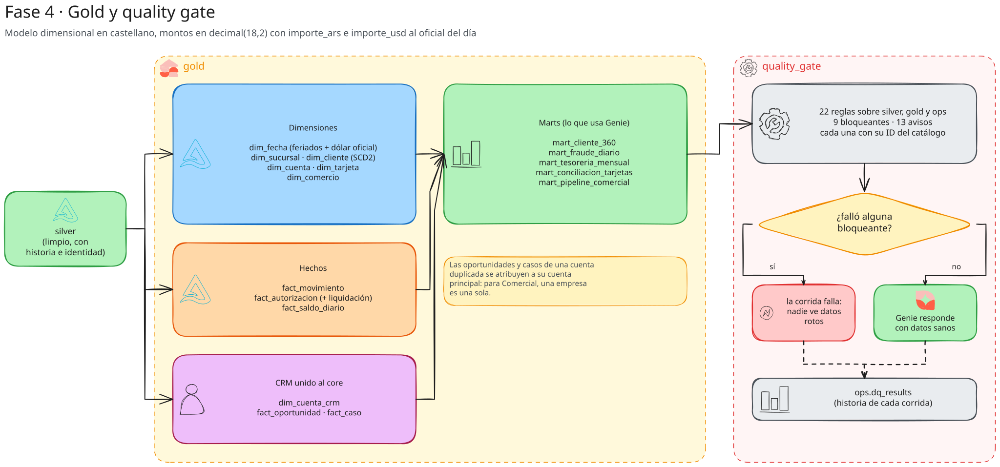
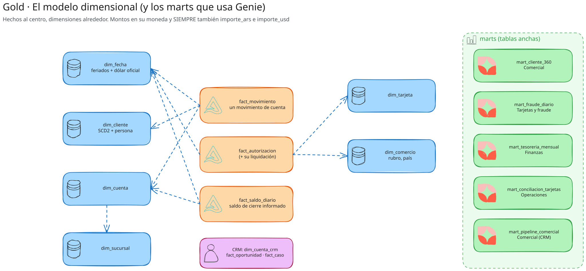

# 06 · Gold y calidad

> Carpetas `src/andes_bank/gold/` y `src/andes_bank/quality/`. Gold es lo que consultan Genie y las áreas: un modelo
> dimensional, tablas anchas por área (marts) y el CRM unido al core. El quality gate decide si esa corrida se publica.

## 1. `gold/model.py`: el modelo estrella

### Convenciones

- **Montos siempre en tres versiones:** `importe` (en su moneda), `importe_ars` e `importe_usd` (al dólar oficial del
  día). Así nadie, ni Genie, tiene que convertir a mano.
- **Reconstrucción completa** en cada corrida: gold es derivado; reconstruirlo es más simple y seguro que mantenerlo
  incremental, y a SF 0,1 tarda minutos.
- **Liquid Clustering** en Databricks (`CLUSTER`): los hechos por fecha + la clave más usada en los filtros.

### Dimensiones

| tabla | grano | de dónde sale | detalles |
|---|---|---|---|
| `dim_fecha` | un día 2023-2026 | calendario armado en Python + `silver.fx_rates` | feriados, día hábil, fin de mes, nombre del mes y del día en castellano. **USD, EUR y BRL oficiales**: los fines de semana y feriados repiten la última cotización publicada (`last(..., ignorenulls)` sobre una ventana ordenada, DAT-13). `cotizacion_publicada` dice si ese día hubo cotización |
| `dim_sucursal` | una sucursal | `reference.branches()` | maestro interno (no viene de un sistema origen) |
| `dim_cliente` | una **versión** de cliente (SCD2) | `customers_history` + `customer_xref` + región | `cliente_sk` = `cliente_id#versión`, `persona_id` (si no tiene par, es el propio cliente), edad y rango de edad al cierre, **banco de origen** (Cuyo original, NOA adquirido, Andes Bank) |
| `dim_cuenta` | una cuenta (versión vigente) | `accounts_history` | CBU y `cbu_valido` |
| `dim_tarjeta` | una tarjeta (vigente) | `cards_history` | |
| `dim_comercio` | un comercio | la autorización más reciente de cada comercio | rubro desde `MCC`, `es_exterior`, `rubro_riesgoso` (electrónica, joyerías, apuestas, servicios digitales, aerolíneas) |

### Hechos

| tabla | grano | qué agrega |
|---|---|---|
| `fact_movimiento` | un movimiento de cuenta | cliente, **persona**, tipo de cuenta, sucursal, `importe_ars`/`importe_usd` con el dólar del día contable, `es_credito` |
| `fact_autorizacion` | una autorización (+ su liquidación) | cliente (por la tarjeta), fecha y **hora local**, `importe_usd`, `aprobada`, `rechazo_por_sospecha`, `liquidada`, `dias_a_liquidar`, diferencia entre lo autorizado y lo liquidado (propinas, tipo de cambio), `llego_tarde` (procesada después del día de la compra) |
| `fact_saldo_diario` | el saldo de cierre de una cuenta en un día informado | `saldo_ars`, `saldo_usd`, `es_fin_de_mes` |

`build_gold(spark, cfg, only)` escribe primero las dimensiones (los hechos las usan) y después los hechos.

## 2. `gold/marts.py`: una tabla ancha por área

Los marts existen para que Genie **no tenga que hacer cinco joins** para una pregunta típica: cada uno responde las
preguntas de un área con un `GROUP BY` simple.

| mart | área | grano | qué tiene |
|---|---|---|---|
| `mart_cliente_360` | Comercial | un **cliente vigente y activo** | productos (cuentas activas, caja en USD, cuenta corriente, tarjetas), cantidad de productos, saldos totales en ARS y USD (último saldo de cada cuenta), movimientos y % digital de los últimos 90 días, si cobra sueldo, último movimiento, consumo con tarjetas y compras en 90 días |
| `mart_fraude_diario` | Fraude | día × rubro × exterior × riesgoso | autorizaciones, aprobadas, rechazos por sospecha y totales, montos, tarjetas distintas, informadas tarde |
| `mart_tesoreria_mensual` | Tesorería | fin de mes × moneda × tipo de cuenta × segmento × región | cuentas y saldos (moneda original, ARS y USD) |
| `mart_conciliacion_tarjetas` | Operaciones | día | compras con débito aprobadas según **el procesador** vs. débitos `COMPRA_DEBITO` según **el core** (full outer join por `auth_id`): sólo en uno, sólo en el otro y diferencia de montos |

**Cómo se llegó al grano de `mart_cliente_360` (bitácora R18):** al principio traía todas las versiones vigentes,
incluidos los clientes **dados de baja**, aunque su comentario decía "un cliente vigente por fila". Genie filtraba
`estado = 'ACTIVO'` (bien) y el benchmark no, y el agent Comercial quedó en 70 %. Se arregló el dato, no el agent:
ahora el mart filtra `is_current AND estado = 'ACTIVO'`, y Comercial pasó a 90 %.

## 3. `gold/crm.py`: el CRM unido al core

| tabla | qué es |
|---|---|
| `dim_cuenta_crm` | cuentas del CRM con su persona del core, nombre y segmento del core, `metodo_match`, `problema_id_core`, duplicadas y `segmento_desactualizado` (el del CRM no coincide con el del core) |
| `fact_oportunidad` | oportunidades atribuidas a la **cuenta principal** (las de una duplicada se suman a la principal: para Comercial, una empresa es una sola) |
| `fact_caso` | casos con la descripción sin PII y `horas_resolucion` |
| `mart_pipeline_comercial` | una fila por persona con actividad en el CRM: oportunidades abiertas, pipeline abierto, ganado, casos abiertos y totales |

`build_crm_gold` no hace nada si todavía no hay CRM en silver (el CRM llega en la etapa 08 del curso).

## 4. `quality/gate.py`: reglas y quality gate

### La idea

Cada regla es **una consulta que cuenta filas que no cumplen** y otra que cuenta contra cuántas se mide. Severidad:

- **`fail`** (bloqueante): si una sola fila no cumple, el gate **frena el job**. Gold no se publica a Genie con datos
  rotos: como el job falla, Genie sigue viendo los datos de la última corrida buena.
- **`warn`**: suciedad conocida y ya tratada que se sigue midiendo (por ejemplo, cuántos CUIT inválidos manda el core).

Cada regla lleva el **ID del catálogo** (`catalog_id`), así un resultado lleva directo a dónde se resuelve.

### Las 22 reglas (9 bloqueantes, 13 de aviso)

| regla | tabla | severidad | problema |
|---|---|---|---|
| `movimiento_unico` | silver.transactions | fail | DAT-01 |
| `importe_informado` | silver.transactions | fail | DAT-02 |
| `moneda_de_la_cuenta` | silver.transactions | fail | DAT-05 |
| `moneda_corregida` | silver.transactions | warn | DAT-05 |
| `hora_en_utc` | silver.transactions | fail | DAT-06 |
| `cuit_valido` | silver.customers_history | warn | DAT-07 |
| `cbu_valido` | silver.accounts_history | warn | DAT-07 |
| `personas_duplicadas` | silver.customer_xref | warn | DAT-08 |
| `observaciones_sin_pii` | silver.customers_history | fail | DAT-11 |
| `saldos_concilian` | silver.balance_breaks | warn | DAT-10 |
| `autorizacion_unica` | silver.card_authorizations | fail | API-05 |
| `dias_api_completos` | ops.api_reconciliation | fail | API-06 |
| `archivos_corruptos` | ops.landing_files | warn | ING-03 |
| `archivos_vacios` | ops.landing_files | warn | ING-02 |
| `archivos_duplicados` | ops.landing_files | warn | ING-01 |
| `cotizacion_dia_habil` | gold.dim_fecha | warn | DAT-13 |
| `dolar_siempre_disponible` | gold.dim_fecha | fail | DAT-13 |
| `movimiento_con_cliente` | gold.fact_movimiento | fail | — |
| `crm_cuentas_sin_match` | silver.crm_accounts | warn | DAT-09 |
| `crm_cuentas_duplicadas` | silver.crm_accounts | warn | DAT-16 |
| `crm_leads_ya_clientes` | silver.crm_leads | warn | DAT-18 |
| `compras_debito_conciliadas` | gold.mart_conciliacion_tarjetas | warn | DAT-10 |

Detalles:

- `dias_api_completos` toma, por recurso y día, **el último intento** (`max_by(complete, checked_at)`): un día que
  quedó incompleto en la primera ronda y se completó en la segunda pasa.
- Las consultas usan `{t}` (la tabla de la regla) y `{s}` (el esquema silver), que se resuelven con la config: la misma
  regla corre en local, en dev y en otro catálogo.

### Funciones

- `Rule`: dataclass con nombre, tabla, SQL de fallas, SQL de total, severidad, ID y descripción.
- `evaluate(spark, cfg, run_id)`: corre todas las reglas y **agrega** los resultados a `ops.dq_results`. Si la tabla
  no existe, la regla `fail` cuenta como no pasada (con error "tabla inexistente"); si la consulta falla, también.
- `gate(spark, cfg, run_id)`: evalúa y lanza `QualityGateError` con el detalle de las reglas bloqueantes que fallaron.

`ops.dq_results` es la historia de la calidad: la vista `semantic.v_calidad` la expone en castellano y el agent
Plataforma de datos responde sobre ella ("¿qué reglas fallaron en la última corrida?").
