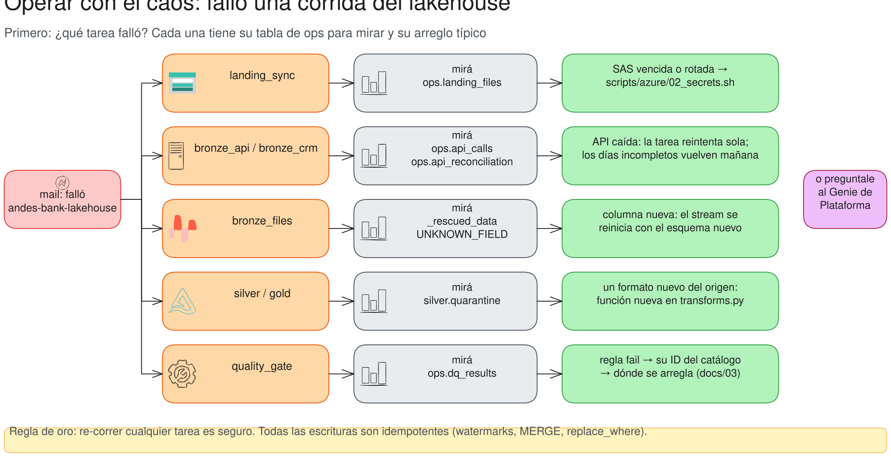

# Operación · Qué hacer cuando algo falla

> Dos jobs corren solos todos los días: `andes-bank-dia-nuevo` a las **5:00** (genera y publica en Azure el día de
> ayer) y `andes-bank-lakehouse` a las **7:00** (hora argentina). Los dos mandan un mail si fallan. Esta guía
> dice qué mirar y qué hacer, tarea por tarea. **Regla de oro: re-correr cualquier tarea es seguro** (todas las
> escrituras son idempotentes).



## 1. ¿Qué tarea falló?

En el mail o en **Jobs & Pipelines → andes-bank-lakehouse → la corrida**. Después, la sección de esa tarea.

```bash
databricks jobs list-runs --job-id <id> --limit 1          # o en la interfaz
databricks bundle run andes_lakehouse -t dev --only <tarea>  # re-correr sólo esa
```

## 2. El job `andes-bank-dia-nuevo`

```sql
SELECT * FROM andes_bank.sim.generated_days ORDER BY day DESC LIMIT 5;   -- hasta qué día está generado el banco
```

| qué ves | qué pasó | qué hacer |
|---|---|---|
| falla `nuevo_dia` con `AuthenticationFailed` | la SAS de escritura venció | `bash scripts/azure/02_secrets.sh` y re-correr |
| falla a la mitad | Spark o Azure | re-correr: el día se borra y se rehace; no se duplica nada |
| no corrió uno o más días | el job estuvo pausado o caído | correrlo una vez: genera todos los que faltan, en orden |
| el lakehouse dice `not_ready_days` | corrió antes que el día nuevo | nada: el día se pide en la corrida siguiente |

## 3. `landing_sync`

```sql
SELECT status, count(*) FROM andes_bank.ops.landing_files
WHERE synced_at > current_date() - 1 GROUP BY ALL;
```

| qué ves | qué pasó | qué hacer |
|---|---|---|
| la tarea falla con `AuthenticationFailed` | la SAS de lectura venció o se rotó | `bash scripts/azure/02_secrets.sh` |
| `CORRUPT` | un archivo llegó roto (ING-03) | esperar el `_REENVIO` del día siguiente; está en `_errors/landing/` |
| `CHANGED` | el sistema origen re-subió un archivo ya entregado | pedirle al origen que mande un archivo nuevo; no se re-copia |
| `EMPTY` | llegó sólo el encabezado (ING-02) | esperar el reenvío |

## 4. `bronze_api` / `bronze_crm` / `bronze_fx`

```sql
SELECT api, resultado, count(*) FROM andes_bank.semantic.v_api_llamadas
WHERE fecha >= current_date() - 1 GROUP BY ALL ORDER BY 3 DESC;

SELECT resource, day, max_by(complete, checked_at) AS completo, max_by(received, checked_at) AS recibidos,
       max_by(expected, checked_at) AS esperados
FROM andes_bank.ops.api_reconciliation GROUP BY ALL HAVING NOT completo;
```

| qué ves | qué pasó | qué hacer |
|---|---|---|
| muchos `ERROR_SERVIDOR` y la tarea falla | la API estuvo caída | la tarea reintenta 2 veces (5 min); si no, re-correrla después |
| días con `completo = false` | páginas salteadas que no se recuperaron en las 3 rondas | nada: el watermark no avanzó y la próxima corrida los vuelve a pedir |
| `invalid_client` (401 en `/oauth/token`) | el client secret de la API cambió | `bash scripts/azure/02_secrets.sh` |
| `bronze_fx` falla con timeout | la API del BCRA no respondió | re-correr; el espejo sirve de respaldo en silver |

## 5. `bronze_files`

| qué ves | qué pasó | qué hacer |
|---|---|---|
| `UNKNOWN_FIELD_EXCEPTION` en el log | columna nueva en un archivo (schema drift) | re-correr: el esquema nuevo ya quedó guardado |
| filas con `_rescued_data` | datos que no encajan en el contrato | mirar el archivo; si el formato cambió, contrato nuevo |

## 6. `silver` / `gold`

```sql
SELECT entidad, motivo, count(*) FROM andes_bank.silver.quarantine
WHERE _quarantined_at > current_date() - 1 GROUP BY ALL;
```

Un motivo nuevo en cuarentena es un formato nuevo del origen: función nueva en `silver/transforms.py`, con su ID en el
catálogo (`docs/03`).

## 7. `quality_gate`

```sql
SELECT regla, severidad, problema, filas_que_fallan, filas_totales
FROM andes_bank.semantic.v_calidad
WHERE run_id = (SELECT max_by(run_id, checked_at) FROM andes_bank.semantic.v_calidad) AND NOT paso;
```

`problema` es el ID del catálogo: `docs/03_catalogo_de_problemas.md` dice dónde se resuelve. Mientras el gate no pase,
Genie sigue viendo los datos de la última corrida buena.

## 8. El costo

```bash
bash scripts/azure/04_costo.sh            # gasto del mes del resource group; tope USD 10
```

## Prueba de volumen (SF 1)

Corrida el 22-oct-2026 en un catálogo aparte (`andes_bank_sf1`), con las tareas que más cómputo usan (generar la verdad
y exportarla sucia), sin subir a Azure:

| | SF 0,1 (el de todos los días) | SF 1 |
|---|---|---|
| clientes | 50.764 | 507.472 |
| cuentas | 80.666 | 805.160 |
| movimientos | 17,2 M | **172,3 M** (6,1 GB en Delta) |
| autorizaciones de tarjeta | 4,5 M | 44,8 M |
| saldos de cierre | 17,7 M | 177,1 M |
| `generate_truth` | 3,5 min | 17,7 min |
| `export_sources` | 5 a 15 min | 24,1 min |
| total (setup + generar + exportar) | ~15 min | **43 min**, sin cortes de cuota |

**Conclusiones:**

- **Escala bien:** 10 veces más datos tardan unas 5 veces más. El generador no tiene pasos cuadráticos: todo es
  `xxhash64`, ventanas y joins por clave.
- **Entra en Free Edition:** la corrida terminó sin que la cuota diaria la frenara.
- **Lo que no se probó a SF 1:** la subida a Azure (10 veces más archivos: más tiempo de `upload_to_azure` y unos
  centavos más de Storage por mes) y el lakehouse completo sobre esos datos. La primera carga del lakehouse va a tardar
  bastante más; las corridas diarias, no tanto, porque sólo procesan lo nuevo de cada día.
- El catálogo de la prueba se borró después (`DROP CATALOG andes_bank_sf1 CASCADE`) para no ocupar espacio. Para
  repetirla:

```bash
# en el SQL editor: CREATE CATALOG IF NOT EXISTS andes_bank_sf1;
databricks jobs run-now --json '{"job_id": <andes-bank-fuentes>, "only": ["setup","generate_truth","export_sources"],
  "job_parameters": {"catalog": "andes_bank_sf1", "scale_factor": "1"}}'
```
